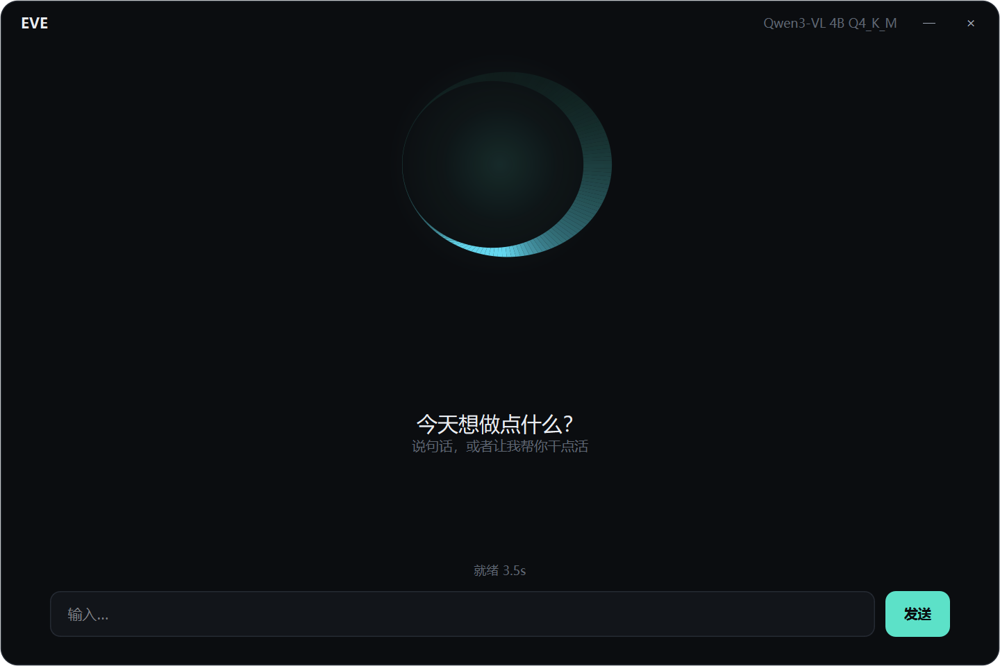
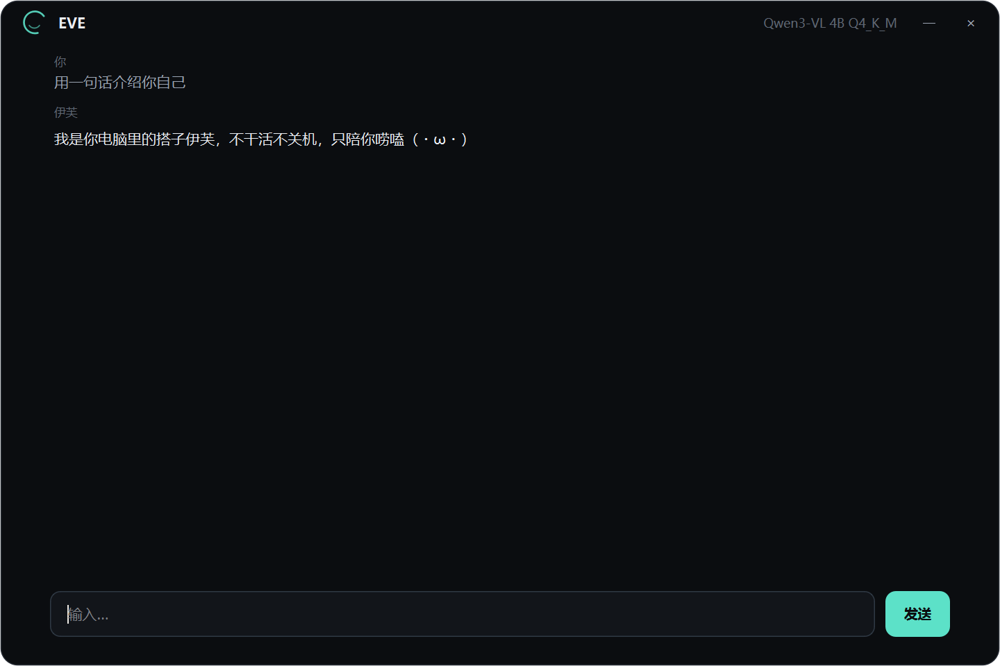

# EVE

本地优先的个人 agent。本地模型负责陪伴与简单的桌面操作，云端模型负责真正干活的事。

## 设计

- **手动切档，不做自动路由**。每个档位 = 一段 system prompt + 一组工具 + 一个默认模型。
- **模型是一等公民**。`[models.*]` 声明有什么，`[modes.*]` 只声明用哪个；换本地模型、换云端厂商都只是改配置。
- **本地模型的引擎在执行时按需拉起**，动态端口，退出即释放。
- 详细设计见 [docs/](docs/)：`design-mvp.md`（整体）、`design-ui.md`（界面）、`design-mascot.md`（形象）、`design-persona.md`（人格）。

| 档位 | 默认模型 | 定位 |
| --- | --- | --- |
| 聊天（`chat`） | 本地 GGUF | 闲聊、陪伴 |
| 桌面（`desktop`） | 本地 GGUF + 视觉 | 开软件、搜索、点击 |
| 工作（`work`） | DeepSeek Flash（云端） | 整理文档、写代码、爬数据 |

## 目录结构

```
eve_core/     核心：配置、provider、运行时、模型扫描、DPAPI 密钥、事件总线
eve_agent/    agent 层：主循环、人格状态机、工具注册表与内置工具
eve_ui/       界面层：theme / mobius（莫比乌斯）/ bridge（Qt 桥）/ main_window / app
eve_cli.py    命令行入口
eve_gui.py    图形界面入口
config.toml   模型与档位配置
prompts/      各档位的 system prompt
tests/        纯逻辑单元测试（不需要模型）
docs/         设计文档与视觉稿
models/       本地模型文件（不入版本库）
logs/         会话日志与引擎日志（不入版本库）
```

## 环境

- Python 3.11：`D:\python\python.exe`（不在 PATH 里，需显式调用）
- 无第三方依赖，只用标准库（`tomllib`、`urllib`、`ctypes`）

## 快速开始

```powershell
# 图形界面（推荐）
& 'D:\python\python.exe' eve_gui.py

# 命令行
& 'D:\python\python.exe' eve_cli.py

# 指定档位 / 临时指定模型
& 'D:\python\python.exe' eve_cli.py --mode desktop
& 'D:\python\python.exe' eve_cli.py --model qwen3vl-4b-small

# 非交互跑一句
& 'D:\python\python.exe' eve_cli.py --once "你好，介绍一下你自己"
```

界面长这样：空态居中一枚莫比乌斯，开口说话后它缩进顶栏，把空间让给对话。




> v0.4.2 起入口拆成 `eve_cli.py` / `eve_gui.py`，原来的 `python -m eve` 已不再可用。

## REPL 命令

| 命令 | 说明 |
| --- | --- |
| `/models` | 列出已配置的模型，`*` 标出当前使用 |
| `/use <id>` | 给当前档位换模型（保留上下文，会重启本地引擎） |
| `/scan` | 扫描 `model_dirs` 下可用的 GGUF，含量化等级与 mmproj 配对 |
| `/mode <name>` | 切换档位（会重置上下文） |
| `/status` | 运行时状态：引擎、端口、pid、加载耗时、日志路径 |
| `/persona` | 人格状态：抗议等级、连续命令数、颜文字节流 |
| `/stop` | 停止本地引擎，释放显存 |
| `/cost` | 本次会话的 token 用量与估算花费（按模型拆账） |
| `/context [n\|auto]` | 查看或设置上下文预算 |
| `/steps [n]` | 查看或设置单条消息的步数上限 |
| `/key <id>` | 为云端模型保存 API Key（DPAPI 加密，不落明文） |
| `/reset` `/tools` `/where` `/help` `/exit` | 常规 |

## 配置要点

```toml
[engines.llamacpp]
bin = "tools/llama.cpp/llama-server.exe"

[models.qwen3vl-4b]
kind = "local_gguf"          # 本地 GGUF
path = "models/....gguf"
mmproj = "models/....gguf"   # 视觉投影，可省
ctx = 8192
ngl = 99

[models.deepseek-flash]
kind = "cloud_api"           # 云端 API
base_url = "https://api.deepseek.com/v1"
model = "deepseek-flash"
api_key_ref = "deepseek"     # Key 存 KeyStore 的这个 id 下，/key deepseek 或界面里配
ctx = 131072
price_in = 2.0               # 元 / 百万 tokens（未命中缓存）
price_out = 8.0
price_cached_in = 0.2        # 命中缓存

[modes.chat]
model = "qwen3vl-4b"         # 档位只绑模型 id，不绑类型

[app]
context_tokens = 0           # 0 = 按窗口自动
max_steps = 12
work_root = "."              # work 档文件工具的根目录
```

## 语音

三种触发方式，随时打断：

- **说「伊芙」**——常听唤醒（KWS）。听到就进录音，说完停一下自动识别。
- **按空格**——输入框空着时按空格等同「开始说」（输入框里有字就照常打空格）。
- **点「语音」按钮 / Ctrl+Space**——同上。

识别结果直接当作用户输入发出去；开头是唤醒词就剥掉。
说「切换到工作」这类话会**直接切档**，不绕模型。

- **识别**：sherpa-onnx 离线中文模型（paraformer），热态约 0.05–0.1 秒/句。
- **唤醒**：sherpa-onnx KWS，拼音建模（「伊芙」= `y ī f ú`），**必须按 100ms 分块喂**，
  整段一次性喂进去检测不到（踩过）。
- **断句**：能量门限 + 静音计时，纯状态机，可单测。
- **播报**：回复会念出来（离线 VITS 中文女声）。念之前先洗文本：去 markdown、
  代码块、颜文字，超过 220 字按标点截断。播报期间暂停唤醒，防止把自己的声音当成唤醒词。
  菜单里可以随时关掉；模型不在时自动退回 Windows 自带音色。
- 全程离线，音频不出本机。`[voice] kws_enabled = false` 可关掉常听，
  `tts_enabled = false` 可关掉播报。

实测：合成语音「伊芙」「伊芙，打开记事本」都能唤醒；「今天天气不错」「打开微信」不误触。
ASR 会把「伊芙」听成「衣服」，所以唤醒词变体里收了它。

模型放在 `models/voice/`（不进版本库），首次使用按下表下载解压：

| 用途 | 模型 |
| --- | --- |
| 识别 | `sherpa-onnx-paraformer-zh-small-2024-03-09`（78 MB） |
| 唤醒 | `sherpa-onnx-kws-zipformer-wenetspeech-3.3M-2024-01-01`（33 MB） |
| 播报 | `vits-zh-hf-eula`（115 MB，22.05 kHz 单人女声） |

`config.toml` 里 `[voice]` 段配置模型路径、唤醒词、静音时长。

## 测试

```powershell
# 纯逻辑与集成测试，不需要模型、不联网（7 个文件 / 106 项）
& 'D:\python\python.exe' tests\test_persona.py
& 'D:\python\python.exe' tests\test_context.py      # 上下文裁剪与摘要
& 'D:\python\python.exe' tests\test_workspace.py    # fs_* / shell_exec 的边界
& 'D:\python\python.exe' tests\test_cost.py         # 计费与用量账本
& 'D:\python\python.exe' tests\test_apps.py         # 开始菜单索引与启动
& 'D:\python\python.exe' tests\test_voice.py        # 唤醒词与断句
& 'D:\python\python.exe' tests\test_agent_loop.py   # 真配置 + 桩模型的主循环
```

## 状态

- [x] v0.1 骨架：配置、provider 抽象、多轮对话、切档、日志
- [x] v0.2 desktop 档：窗口枚举/激活、键鼠注入、中文输入、动作日志
- [x] v0.3 本地档打磨：重复启动复用窗口、窗口关闭、工具级自测
- [x] v0.4 模型抽象：ModelCatalog + RuntimeManager，本地/云端统一切换，引擎懒启动
- [x] v0.4.1 修复：窗口标题异步变化导致的定位失败
- [x] v0.4.2 结构重构：按功能拆成 `eve_core` / `eve_agent` / `eve_ui`
- [x] v0.4.3 事件通道 + 人格状态机：事件总线、抗议分级、颜文字节流、单元测试
- [x] v0.5.0 主窗口：PySide6 无边框窗口、参数化莫比乌斯、事件驱动状态、agent 跑在子线程
- [x] v0.5.1 流式输出：provider 支持 SSE，逐段渲染；空态加建议入口、加大留白限制行长
- [x] v0.5.2 聊天结构：头像 + 左右气泡 + 时间戳 + 进入动效 + 顶栏状态点
- [x] v0.5.3 空态到对话的过渡：莫比乌斯飞入顶栏 + 交叉淡入
- [x] v0.5.4 agent 接线：档位切换菜单、工具确认弹窗、工具调用可视化
- [x] v0.5.5 悬浮球：玻璃球 + 光点眼 + 气泡汇报；agent 模式自动收起主窗
- [x] v0.5.6 联网工具：web_search（Bing RSS）与 http_get（正文抽取）
- [x] v0.5.7 云端接入：DeepSeek Flash/Pro + 官方 Search/Fetch 作为联网后端
- [x] v0.5.8 开始菜单：`app_launch` 走 `Get-StartApps`（本机 335 条），支持中文名；新增 `app_list`
- [x] v0.5.9 许可气泡：工具确认改为界面内卡片 / 悬浮球气泡；`app_launch(file=)` 直接开文件；`key_type(save=)`；修复长参数被 `max_tokens` 截断
- [x] v0.5.10 模型面板：顶栏点模型名切模型（带单价）、`ctx` 胶囊调预算与步数、界面内配置 API Key；`work` 档默认改 DeepSeek Flash
- [x] v0.6.0 语音输入：麦克风采集 + 静音断句 + sherpa-onnx 离线识别 + 文本级唤醒词「伊芙」（语音按钮 / Ctrl+Space）
- [x] v0.6.1 常听唤醒 + 语音切档：说「伊芙」直接进录音；空格键也能说话；三个档位显示为聊天 / 桌面 / 工作；说「切换到工作」直接切档
- [x] v0.6.2 语音播报：离线 VITS 女声（22.05 kHz），念之前洗文本；播报时暂停唤醒防自激；菜单可一键静音
- [ ] v0.7 打包：PyInstaller spec + 首次运行向导

## 实测数据

### desktop 档

| 场景 | 结果 |
| --- | --- |
| 「打开记事本」 | `app_launch` → 返回真实窗口标题与 hwnd，一步到位 |
| 「打开记事本并输入 hello from eve」 | 3 步（启动 → 激活 → 输入），约 2 秒 |
| 「输入：你好，我是 EVE」 | 中文走剪贴板 + Ctrl+V，正常 |
| 重复「打开记事本」 | 检测到进程已在运行，直接激活原窗口，不再开新实例 |
| 「关闭记事本」 | `window_close` 发送 WM_CLOSE，窗口消失；有未保存内容会提示 |

### 模型与运行时

| 场景 | 结果 |
| --- | --- |
| 本地模型生成 | 约 66 tok/s（Qwen3-VL-4B Q4_K_M，RTX 4060 Laptop 8G） |
| 引擎加载 | 3.4–3.8 秒 |
| `/use` 热切换 | 换端口、换 pid、各 3.4 秒，退出无残留 |
| `/scan` | 0.2 秒（不加载模型） |
| 云端 flash 单轮 | 约 1.3 秒 |
| 上下文压缩（本地 4B） | 10194 → 471 tokens，摘要 46 字，关键事实保住 |

### agent 端到端

| 场景 | 结果 |
| --- | --- |
| 「写贪吃蛇并保存」（本地 4B，desktop 档） | 4 步，自己选了记事本，最终 74 行 pygame 代码 |
| 「写贪吃蛇并保存」（DeepSeek Flash） | 8 步，**自己选了 VS Code**，118 行 tkinter 代码，41312 tokens / ¥0.045 |
