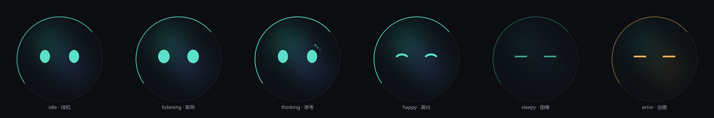

# EVE 形象设计（v0.5 补充）

> 结论先行：**莫比乌斯只属于对话窗口，悬浮球是一张会做表情的脸。**
> 两者不是两个控件，是同一个存在的两种形态。

---

## 0. 一个存在的两种形态

| 形态 | 出现场景 | 象征 |
| --- | --- | --- |
| 莫比乌斯缎带 | 对话窗口（空态主视觉 / 顶栏指示） | 思考中的她——连续、抽象、没有五官 |
| 玻璃球 + 光点眼 | 悬浮球（常驻桌面） | 在场的她——有注视、有情绪 |

**切换动画**：缎带收拢 → 卷曲 → 聚成球体，约 600ms，同时亮起两只眼睛。
反向同理。这一个动作就把"两个东西"缝成了"一个角色"。

---

## 1. 球怎么画

| 层 | 做法 |
| --- | --- |
| 底 | 近黑球体，不是纯黑，留一点冷调 |
| 内部 | 两团模糊极光（青绿 + 紫蓝），缓慢漂移，表示"里面有东西在动" |
| 边缘 | 一圈极暗的完整描边 + 上左一段明亮弧光（主光源） |
| 眼睛 | 两个发光椭圆，带轻微辉光 |

**为什么不做嘴**：84px 下嘴会糊成一条脏线，而且一旦有嘴，用户就会期待它说人话、做表情管理，期望值失控。只用眼睛反而更高级，也更可控。

**为什么不用白色眼珠**：发光眼在深色背景上对比更强、更好看，且不需要画瞳孔高光这种容易被看穿的小把戏。

---

## 2. 表情不是图片，是参数

每个表情由这几个参数决定，全部可插值：

| 参数 | 取值 | 作用 |
| --- | --- | --- |
| `eye` | `oval` / `wide` / `arc` / `line` | 眼形：平静 / 专注 / 开心 / 闭眼 |
| `gaze` | `(dx, dy)` | 视线偏移，最多 ±6px |
| `lid` | 0–1 | 眼皮下压程度（配合眨眼、困倦） |
| `glow` | 0–1.3 | 内部极光与边缘光强度 |
| `tint` | 色相 | 正常青绿 / 出错琥珀 |
| `pulse` | bool | 外圈脉冲（聆听时） |

好处：**任意两个表情之间都能平滑过渡**，不需要画过渡帧。

### 六个基础表情

| 表情 | 触发 | 形状 |
| --- | --- | --- |
| `idle` | 空闲 | 两个椭圆，缓慢呼吸 |
| `listening` | 语音拾音 | 眼睛略放大 + 外圈脉冲 |
| `thinking` | 等模型出字 | 眼睛偏上看，旁边三点转圈 |
| `happy` | 任务成功 / 被夸 | 弯月眼（∩∩） |
| `sleepy` | 长时间无交互 | 横线眼，亮度降到 0.35 |
| `error` | 调用失败 | 横线眼，整体转琥珀色 |

---

## 3. 状态映射（agent 事件 → 表情）

| 事件 | 表情 | 附加 |
| --- | --- | --- |
| `engine_starting` | `thinking` | 眼睛盯住球心 |
| `engine_ready` | `happy` 一闪 | 200ms 后回 `idle` |
| `thinking` | `thinking` | — |
| `tool_start` | `thinking` + 视线偏向气泡 | 像在"看着自己正在做的事" |
| `tool_end` 成功 | `happy` 一闪 | — |
| `tool_end` 失败 | `error` | 500ms 后回 `idle` |
| `reply_done` | `idle` | 轻轻点头一次 |
| 用户说话 | `listening` | — |

⚠️ **表情不能滥用**。每次任务成功都蹦一个笑脸，三次之后就变成噪音。所以"happy 一闪"限定 200ms，且同一任务内最多出现两次。

---

## 4. 微行为（让它像活的）

| 行为 | 频率 | 说明 |
| --- | --- | --- |
| 眨眼 | 每 4–9 秒随机 | 120ms，单次或连眨两下 |
| 呼吸 | 持续 | 整体缩放 1.00→1.02，4 秒一周期 |
| 看鼠标 | 持续 | 视线朝鼠标偏移，最大 ±6px，200ms 缓动 |
| 点头 | 事件驱动 | 确认时上下 3px，两下 |
| 打哈欠 | 空闲 > 10 分钟 | 眼睛变横线 + 缩放一次，仅一次 |
| 说话脉动 | TTS 播放时 | 亮度随音量脉动 |

**"看鼠标"是性价比最高的一个**：只加十几行代码，但用户会觉得它在注意自己。

---

## 5. 性格驱动（需要你补充）

性格不只体现在话术，更体现在**没人理它的时候它在干什么**。

举几个例子说明这种映射怎么工作：

| 性格/爱好 | 对应待机行为 |
| --- | --- |
| 喜欢音乐 | 空闲时球体轻微左右摇摆，像在打拍子 |
| 喜欢天文 | 每隔几分钟飘起一颗小星点，然后消散 |
| 好奇心重 | 鼠标快速移动时，视线追得更紧 |
| 有点小傲娇 | 被连续打断两次后，眼神偏开 0.5 秒再回来 |

这些都不需要新美术资源，只需要在参数上加一条时间曲线。

---

## 6. 能力边界（说清楚）

**我能做的**：程序化绘制——几何、光影、参数化表情、任意插值动画。上面那张六联图就是我用代码画出来的。

**我做不了的**：插画立绘、3D 建模、手绘角色。

如果最终想要"有头发、有衣服、有立绘的角色"，就必须引入美术资源，并面对两个现实问题：

1. **资源**：需要 sprite sheet 或 Live2D 模型，要么外包，要么找现成的（版权、风格匹配都是坑）
2. **一致性**：84px 的球里放不下立绘；主窗口放大后又需要高分辨率版本。两套资源要维护

**我的建议**：先用玻璃球，角色感靠"说话方式 + 微行为 + 性格设定"建立。等 EVE 用起来真的顺了，再考虑要不要给她一张脸。

---

## 7. 待确认

1. 性格关键词（3 个）、说话风格、爱好 —— 用来生成待机行为清单
2. 她怎么称呼你、你怎么称呼她（EVE / 伊芙 / 小伊）
3. 出错时的反应倾向：冷静说明 / 自嘲 / 道歉 / 卖萌
4. 要不要"记得上次聊到哪"的连续性（影响存储设计）
